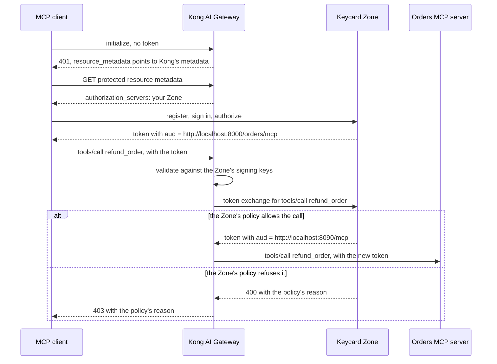

# Kong AI Gateway with Keycard

Put an MCP server behind [Kong AI Gateway](https://developer.konghq.com/ai-gateway/) and let a Keycard Zone decide who can use it and which tools they can call.

Kong is the enforcement point. It publishes protected resource metadata that names your Zone, answers `401` to a request without a token, and accepts only tokens your Zone issued for this endpoint. Your Zone is the authorization server: MCP clients register with it, send the user to sign in, and come back with a token whose `aud` is the MCP endpoint.

On every MCP request, Kong then exchanges the caller's token at your Zone ([RFC 8693](https://www.rfc-editor.org/rfc/rfc8693)) and names the method or tool in the request as an [RFC 9396](https://www.rfc-editor.org/rfc/rfc9396) authorization detail, so the Zone's policy decides that one call. If the policy allows it, the Zone issues a token for the MCP server and Kong forwards the request with it. If not, Kong answers `403` with the Zone's reason and the request never reaches the server. Every sign-in, exchange, and refusal lands in the Zone's Audit Log.



## What's in the repository

| Path | What it is |
| --- | --- |
| `orders-mcp/` | An MCP server with one tool that reads (`list_orders`) and one that writes (`refund_order`). The orders live in memory. It accepts only tokens your Zone issued to Kong for this server. |
| `scripts/kong-dataplane.sh` | Creates an AI Gateway in Konnect and runs a local data plane for it in Docker on port 8000. These are the steps Kong's AI quickstart takes, written out. |
| `keycard/setup.sh` | Registers Kong's MCP endpoint as a Resource in your Zone. |
| `keycard/setup-exchange.sh` | Creates an Application for Kong with a client credential, registers the orders server as a second Resource, and lets Kong reach it only for callers using Kong's endpoint. |
| `keycard/block-refunds.sh` | Copies your Zone's default policies as the Policy Set `kong-tutorial`, adds a policy that forbids `refund_order`, and activates the copy. |
| `kong/kong.yaml` | The Kong config: an `openid-connect` AI Auth Strategy pointed at your Zone, a Request Callout policy that exchanges the caller's token on every request, and the MCP server with protected resource metadata. |
| `scripts/exchange-logger.py` | Optional. Sits between Kong and your Zone and logs each exchange Kong sends, with tokens shown only as fingerprints. |

## Prerequisites

- A [Konnect](https://cloud.konghq.com) account and a personal access token in `KONNECT_TOKEN`
- [kongctl](https://developer.konghq.com/kongctl/): `brew install --formula kong/kongctl/kongctl`
- A [Keycard](https://console.keycard.ai) account with a Zone, and a service account credential for the Management API (Organization → **Service Accounts** → **Create service account** → **Add credential**)
- Docker, Python 3.12 or later, and [uv](https://docs.astral.sh/uv/)
- An MCP client. The steps below use Claude Code.

## Run it

1. **Start Kong.**

   ```bash
   ./scripts/kong-dataplane.sh
   ```

   The script prints `export AI_GATEWAY_ID=...`. Run that line.

2. **Set up your Zone.**

   ```bash
   export KEYCARD_CLIENT_ID=<service-account-client-id>
   export KEYCARD_CLIENT_SECRET=<service-account-client-secret>
   export KEYCARD_ISSUER=https://<zone-id>.keycard.cloud
   ./keycard/setup.sh
   ./keycard/setup-exchange.sh
   ```

   `setup.sh` registers Kong's endpoint, `http://localhost:8000/orders/mcp`, as a Resource with the scope `mcp:tools`. `setup-exchange.sh` creates the Application that Kong authenticates as when it exchanges tokens, saves its client ID and secret to `kong-gateway.env` (git ignores it), and registers the orders server as the Resource `http://localhost:8090/mcp`. Both scripts end with `export` lines for the next steps. Run them.

3. **Start the MCP server.** In a new terminal, from the repository root:

   ```bash
   export KEYCARD_ISSUER=https://<zone-id>.keycard.cloud
   export GATEWAY_CLIENT_ID=$(sed -n 's/^KONG_KEYCARD_CLIENT_ID=//p' kong-gateway.env)
   cd orders-mcp
   uv run orders-mcp
   ```

   It listens on `http://localhost:8090/mcp` and accepts a token only if your Zone issued it for this server to Kong's Application. Leave it running.

4. **Apply the Kong config.** Back in the first terminal:

   ```bash
   set -a; . ./kong-gateway.env; set +a
   export KONG_KEYCARD_BASIC="Basic $(printf '%s:%s' "$KONG_KEYCARD_CLIENT_ID" "$KONG_KEYCARD_CLIENT_SECRET" | base64 | tr -d '\n')"
   export ORDERS_MCP_URL=http://host.docker.internal:8090/mcp
   export KONGCTL_DEFAULT_KONNECT_PAT="$KONNECT_TOKEN"
   kongctl adopt ai-gateway "${AI_GATEWAY_NAME:-kong-keycard-tutorial}" --namespace kong-keycard-tutorial
   kongctl apply -f kong/kong.yaml --auto-approve
   ```

   Konnect pushes the config to the data plane within a few seconds. Kong's client secret is part of the policy's config in Konnect, so anyone who can read this AI Gateway's config can read it.

5. **Check Kong without a token.**

   ```bash
   curl -i -X POST http://localhost:8000/orders/mcp \
     -H 'content-type: application/json' \
     -H 'accept: application/json, text/event-stream' \
     -d '{"jsonrpc":"2.0","method":"initialize","params":{"protocolVersion":"2025-06-18","capabilities":{},"clientInfo":{"name":"curl","version":"1.0"}},"id":1}'
   ```

   Kong answers `401`, and the `WWW-Authenticate` header points at its protected resource metadata:

   ```http
   HTTP/1.1 401 Unauthorized
   WWW-Authenticate: Bearer realm="<zone-id>.keycard.cloud", resource_metadata="http://localhost:8000/.well-known/oauth-protected-resource/orders/mcp", scope="mcp:tools", error="invalid_token"
   ```

   The metadata names your Zone:

   ```bash
   curl -s http://localhost:8000/.well-known/oauth-protected-resource/orders/mcp
   ```

   ```json
   {"resource":"http://localhost:8000/orders/mcp","scopes_supported":["mcp:tools"],"authorization_servers":["https://<zone-id>.keycard.cloud"]}
   ```

6. **Connect Claude Code and sign in.**

   ```bash
   claude mcp add --transport http orders http://localhost:8000/orders/mcp
   claude
   ```

   Run `/mcp`, select **orders**, then **Authenticate**. Claude Code reads Kong's metadata, registers with your Zone, and opens the Zone's sign-in page. Sign in, then ask Claude to list the orders.

   If Claude Code has connected to this URL before with a different Zone, choose **Clear authentication** before **Authenticate**. Otherwise it can keep using tokens from the old Zone, and Kong rejects them.

   Your Zone's default policies allow every tool, so Claude lists three orders. The MCP server's terminal shows `accepted a token for sub=<user-id> from the gateway` for each request Kong forwarded.

   In Keycard Console, the Zone's **Audit Log** shows your sign-in and a `credentials:issue` with the `authorization_code` grant, issued to you through the client Claude Code registered. After that comes one `credentials:issue` with the token exchange grant for each MCP request, issued to you through Kong's Application.

7. **Take refunds away.**

   ```bash
   ./keycard/block-refunds.sh
   ```

   Ask Claude to refund order A-1002. Kong answers `403`, and Claude shows the Zone's reason:

   ```text
   Keycard refused this call: Action "mcp::tools/call::refund_order" on "Orders MCP server" is denied by Policy "orders-no-refunds" in version 2 of Policy Set "kong-tutorial".
   ```

   The version number can differ. Ask Claude to list the orders again: listing still works, and A-1002 is still `pending`, because the refund never reached the MCP server. The Audit Log shows that exchange as a `credentials:issue` failure with the same reason.

   To give refunds back, activate `default-zone-policies` again in Console. To take them away again, activate `kong-tutorial` in Console. Running `block-refunds.sh` a second time doesn't do it, because the script stops when the `orders-no-refunds` policy already exists.

8. **Optional: watch the exchanges.**

   ```bash
   KEYCARD_TOKEN_URL=https://<zone-id>.keycard.cloud/oauth/2/token python3 scripts/exchange-logger.py
   ```

   Then run the `kongctl apply` from step 4 again with `KEYCARD_TOKEN_URL=http://host.docker.internal:8099/oauth/2/token`. For each exchange Kong sends, the logger prints one JSON line with the `authorization_details`, the Zone's status and any error, and fingerprints of the tokens, and appends it to `exchange-log.jsonl`. Point `KEYCARD_TOKEN_URL` back at your Zone when you're done.

## How the Kong config fits together

Sign-in, in the `keycard` AI Auth Strategy and the MCP server:

- `issuer` is your Zone URL, and `jwks_endpoint` is `<zone-url>/openidconnect/jwks`, where the Zone publishes its signing keys.
- `audience_required` is the Resource identifier, so Kong refuses a token your Zone issued for a different Resource.
- `access.metadata` on the MCP server makes Kong serve protected resource metadata and check the token's audience. `resource` has to equal the Resource identifier in Keycard exactly, including the `/orders/mcp` path.
- `hide_credentials: false` keeps the caller's token on the request so the exchange can send it to your Zone. The exchange then replaces it, so the caller's token never reaches the MCP server.

The exchange, in the `keycard-exchange` Request Callout:

- `request.by_lua` reads the JSON-RPC message and builds the token exchange. For `tools/call` it names the tool. For `tools/list`, `prompts/list`, `resources/list`, and `resources/templates/list` it names the method. Everything else, such as `initialize` or a notification, goes as `initialize`, so a policy can decide each tool call and each of those list methods on its own, but not other methods. A batch, or a `tools/call` without a valid tool name, gets `400` before Kong asks the Zone.
- `server` at the top of that Lua is the orders server's Resource identifier. It's set in the Lua rather than from the environment, so change it there if yours is different.
- The callout sends Kong's client ID and secret in its `Authorization` header. Only the Application that provides a Resource can exchange tokens issued for it, which is why `setup-exchange.sh` makes Kong's Application the provider of Kong's endpoint.
- `cache.bypass: true` sends every request to the Zone, so each call gets its own decision.
- `upstream.by_lua` swaps in the token the Zone issued, or answers `403` with the Zone's reason if it refused.

The exchanged token doesn't say which tool it was issued for. So the orders server accepts a token only if your Zone issued it to Kong's Application (`GATEWAY_CLIENT_ID`), and a token for the server obtained any other way can't skip Kong's per-call decision.

## Clean up

```bash
docker rm -f "${AI_GATEWAY_NAME:-kong-keycard-tutorial}-gateway"
rm kong-gateway.env
```

Delete the AI Gateway in Konnect. In Keycard Console, activate `default-zone-policies` again, then remove the `kong-tutorial` Policy Set, the Kong AI Gateway Application, and both Resources if you no longer need them.

## Tested with

Kong AI Gateway 2.3.0 data plane (`kong/kong-ai-gateway:latest` on 2026-11-06), kongctl 1.26.0, FastMCP 4.1.6, and Claude Code 2.1.319, against a new Keycard organization on 2026-11-09.

## License

Apache-2.0 — see [LICENSE](LICENSE) and, for the copyright notice,
[NOTICE](NOTICE). The Keycard name and logo are trademarks;
[TRADEMARKS.md](TRADEMARKS.md) states how they may be used.
