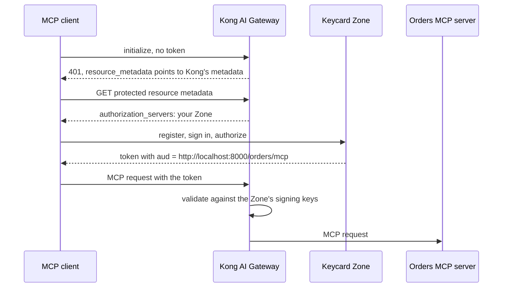

# Kong AI Gateway with Keycard

Put an MCP server behind [Kong AI Gateway](https://developer.konghq.com/ai-gateway/) and let a Keycard Zone decide who can use it.

Kong is the enforcement point. It publishes protected resource metadata that names your Zone, answers `401` to a request without a token, and forwards only requests that carry a token your Zone issued for this endpoint. Your Zone is the authorization server: MCP clients register with it, send the user to sign in, and come back with a token whose `aud` is the MCP endpoint. Every sign-in and token issuance lands in the Zone's Audit Log.

This repository covers sign-in so far. Per-call token exchange, where the Zone's policy decides each tool call, is being added next.



## What's in the repository

| Path | What it is |
| --- | --- |
| `orders-mcp/` | An MCP server with one tool that reads (`list_orders`) and one that writes (`refund_order`). The orders live in memory. |
| `scripts/kong-dataplane.sh` | Creates an AI Gateway in Konnect and runs a local data plane for it in Docker on port 8000. These are the steps Kong's AI quickstart takes, written out. |
| `keycard/setup.sh` | Registers Kong's MCP endpoint as a Resource in your Zone. |
| `kong/kong.yaml` | The Kong config: an `openid-connect` AI Auth Strategy pointed at your Zone, and the MCP server with protected resource metadata. |

## Prerequisites

- A [Konnect](https://cloud.konghq.com) account and a personal access token in `KONNECT_TOKEN`
- [kongctl](https://developer.konghq.com/kongctl/): `brew install --formula kong/kongctl/kongctl`
- A [Keycard](https://console.keycard.ai) account with a Zone, and a service account credential for the Management API (Organization → **Service Accounts** → **Create service account** → **Add credential**)
- Docker, Python 3.12 or later, and [uv](https://docs.astral.sh/uv/)
- An MCP client. The steps below use Claude Code.

## Run it

1. **Start the MCP server.**

   ```bash
   cd orders-mcp
   uv run orders-mcp
   ```

   It listens on `http://localhost:8090/mcp`. Leave it running and use another terminal for the rest.

2. **Start Kong.**

   ```bash
   ./scripts/kong-dataplane.sh
   ```

   The script prints `export AI_GATEWAY_ID=...`. Run that line.

3. **Register Kong's endpoint in your Zone.**

   ```bash
   export KEYCARD_CLIENT_ID=<service-account-client-id>
   export KEYCARD_CLIENT_SECRET=<service-account-client-secret>
   export KEYCARD_ZONE_ID=<zone-id>
   ./keycard/setup.sh
   ```

   The Resource identifier is `http://localhost:8000/orders/mcp`, with the scope `mcp:tools`. The script prints three `export` lines for the next step. Run them.

4. **Apply the Kong config.**

   ```bash
   export ORDERS_MCP_URL=http://host.docker.internal:8090/mcp
   export KONGCTL_DEFAULT_KONNECT_PAT="$KONNECT_TOKEN"
   kongctl adopt ai-gateway kong-keycard-tutorial --namespace kong-keycard-tutorial
   kongctl apply -f kong/kong.yaml --auto-approve
   ```

   Konnect pushes the config to the data plane within a few seconds.

5. **Check Kong without a token.**

   ```bash
   curl -i -X POST http://localhost:8000/orders/mcp \
     -H 'content-type: application/json' \
     -H 'accept: application/json, text/event-stream' \
     -d '{"jsonrpc":"2.0","method":"initialize","params":{"protocolVersion":"2025-06-18","capabilities":{},"clientInfo":{"name":"curl","version":"1.0"}},"id":1}'
   ```

   Kong answers `401`, and the `WWW-Authenticate` header points at its protected resource metadata:

   ```http
   HTTP/1.1 401 Unauthorized
   WWW-Authenticate: Bearer realm="<zone-id>.keycard.cloud", resource_metadata="http://localhost:8000/.well-known/oauth-protected-resource/orders/mcp", scope="mcp:tools", error="invalid_token"
   ```

   The metadata names your Zone:

   ```bash
   curl -s http://localhost:8000/.well-known/oauth-protected-resource/orders/mcp
   ```

   ```json
   {"resource":"http://localhost:8000/orders/mcp","scopes_supported":["mcp:tools"],"authorization_servers":["https://<zone-id>.keycard.cloud"]}
   ```

6. **Connect Claude Code and sign in.**

   ```bash
   claude mcp add --transport http orders http://localhost:8000/orders/mcp
   claude
   ```

   Run `/mcp`, select **orders**, then **Authenticate**. Claude Code reads Kong's metadata, registers with your Zone, and opens the Zone's sign-in page. Sign in, then ask Claude to list the orders.

   In Keycard Console, the Zone's **Audit Log** shows `users:authenticate`, `oauth2:authorize`, and a `credentials:issue` with the `authorization_code` grant, issued to you through the client Claude Code registered.

## How the Kong config fits together

- `issuer` is your Zone URL, and `jwks_endpoint` is `<zone-url>/openidconnect/jwks`, where the Zone publishes its signing keys.
- `audience_required` is the Resource identifier, so Kong refuses a token your Zone issued for a different Resource.
- `access.metadata` on the MCP server makes Kong serve protected resource metadata and check the token's audience. `resource` has to equal the Resource identifier in Keycard exactly, including the `/orders/mcp` path.
- `hide_credentials: true` tells Kong to remove the caller's token before it forwards the request to the MCP server.

## Clean up

```bash
docker rm -f kong-keycard-tutorial-gateway
```

Delete the AI Gateway in Konnect and the Resource in Keycard Console if you no longer need them.

## Tested with

Kong AI Gateway 2.3.0 data plane (`kong/kong-ai-gateway:latest` on 2026-11-06), kongctl 1.26.0, FastMCP 4.1.6, and Claude Code 2.1.319, against a new Keycard Zone on its default access policies.
